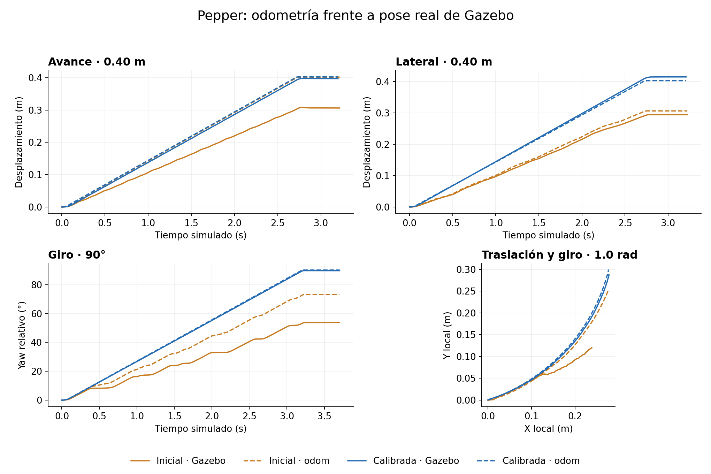

# Calibración de la base · 6 de noviembre de 2026

Gazebo Harmonic, Bullet Featherstone y la descripción actual de Pepper. La
configuración ajustada reduce el máximo error odometría–Gazebo de 13.86 cm a
1.34 cm en el plan de velocidad moderada. Pasan 15 de 16 ensayos. Queda una
excepción lateral de 3.25° frente al criterio de 2.86°. A velocidad alta la
precisión empeora; esa validación tiene 5 fallos en 8 ensayos.

Los criterios no se relajaron para declarar aprobados los resultados. Las
pruebas unitarias verifican el análisis; los ensayos físicos tienen su propio
estado aprobado/fuera de criterio, registrado aunque la ejecución termine correctamente.

## Cambios aplicados

| Parámetro | Inicial | Ajustado |
| --- | ---: | ---: |
| `robot_radius` cinemático | 0.176156322 m | 0.1746 m |
| `wheel_radius` cinemático | 0.070 m | 0.0698 m |
| Discretización de rodillos por rueda | 12 | 24 |
| Fricción deslizante de rodillo y suelo | 1.0 | 1.0 |
| Fricción torsional del suelo | implícita | 0.0 explícita |

La causa dominante era el contacto con el suelo. El backend de
[Bullet Featherstone](https://github.com/gazebosim/gz-physics/blob/gz-physics7/bullet-featherstone/src/SDFFeatures.cc)
parte de un coeficiente torsional de 1.0 si no se declara. Bullet combina las
fricciones de giro como `sA*muB + sB*muA`, según su
[combinador de contactos](https://github.com/bulletphysics/bullet3/blob/master/src/BulletCollision/CollisionDispatch/btManifoldResult.cpp).
Por eso el cero ya existente en el rodillo no anulaba por sí solo la resistencia
que introducía el suelo. Declarar el cero en ambas superficies elimina ese
freno numérico del perfil de simulación; no es una medición del material real.

Los radios nuevos son coeficientes **efectivos del controlador**, estimados a
partir de velocidades en marcha del cribado con 24 rodillos y suelo corregido.
Los coeficientes se comprobaron después con nuevas repeticiones. La validación
posterior dio ganancias globales verdad/odom de 1.000779 en traslación y
1.000277 en giro. No se
extrapolan esos coeficientes fuera de los movimientos medidos.

Las dimensiones, masas y joints de `pepper_description` permanecen intactos.
La esfera nominal de rueda sigue teniendo radio 0.070 m, y los contactos
conservan masa, centro de masa e inercia agregados. Los centros originales son:

| Rueda | X desde `base` (m) | Y (m) | Distancia XY al centro (m) |
| --- | ---: | ---: | ---: |
| Delantera izquierda | 0.090 | 0.155 | 0.179234 |
| Trasera | -0.170 | 0.000 | 0.170000 |
| Delantera derecha | 0.090 | -0.155 | 0.179234 |

El [controlador estándar](https://control.ros.org/jazzy/doc/ros2_controllers/omni_wheel_drive_controller/doc/userdoc.html)
sigue suponiendo 120° entre ruedas. Dos radios
escalares no pueden representar exactamente esas asimetrías y los ejes reales.

## Ensayos y medición

- Avance, retroceso y laterales: 0.40 m a 0.15 m/s.
- Giros izquierda/derecha: 90° a 0.50 rad/s.
- Arcos: `(vx, vy, wz) = (0.12, ±0.04, ±0.30)` hasta 1.0 rad de giro.
- Configuración inicial: una repetición por caso. Ajustada: dos repeticiones.
- Mismo mundo plano, paso de 1 ms, postura inicial, Bullet y sensores de producción.
  Las cámaras funcionan a 15 Hz en los conjuntos inicial, ajustado y de velocidad alta.
  Solo los cribados exploratorios usan cámaras a 1 Hz; sus perfiles están registrados.

La referencia integra el Twist **aplicado**, después de límites y rampas, con
retención de orden cero y exponencial SE(2). La prueba termina por esa integral;
no usa la pose real para corregir el movimiento ni obliga a odom a coincidir con ella.
El muestreo introduce una pequeña diferencia entre distancia nominal e integrada,
conservada en `reference_path_m` y `reference_pose` de cada resultado.

La pose real procede directamente de `gz.msgs.Pose_V` en
`/world/minimal_world/pose/info`; se verificó el tipo mediante `gz topic -l/-i`.
La otra fuente es `nav_msgs/msg/Odometry` en `/base_controller/odom`.
Se usan timestamps nativos de simulación, se desenvuelve yaw y se interpola a
50 Hz en el intervalo común. Cada trayectoria se expresa respecto al origen y
orientación inicial de su propia fuente; no se comparan orígenes absolutos de
`odom` y `world`. La pose del modelo corresponde a la raíz `base_link`.

El error final es `norm(delta_xy_odom - delta_xy_gz)`, y el angular es la
diferencia de yaw relativo. La velocidad real se obtiene de diferencias
centradas de pose en una ventana de 100 ms y se expresa en el frame del robot.
El Twist de odometría se promedia con la misma ventana para no atribuir al
robot el desfase de filtrar solo una fuente. Se conservan los datos sin filtrar.

Criterios de ingeniería del ensayo, no especificaciones del hardware: posición
final y seguimiento de referencia ≤máximo(3 cm, 5% del recorrido); orientación
≤0.05 rad; RMSE de velocidad ≤0.03 m/s y ≤0.05 rad/s; inclinación ≤0.10 rad;
variación de altura ≤1 cm; huecos de muestreo ≤0.10 s.

## Resultados

Errores de odometría frente a Gazebo. Inicial: una muestra. Ajustada: media de
dos repeticiones; RMSE: máximo de esas dos. Los valores angulares son absolutos.

| Caso | Posición inicial (cm) | Posición ajustada (cm) | Yaw inicial (°) | Yaw ajustado (°) | RMSE lineal (m/s) | RMSE giro (rad/s) |
| --- | ---: | ---: | ---: | ---: | ---: | ---: |
| forward | 9.56 | 0.45 | 0.00 | 0.35 | 0.0083 | 0.0065 |
| backward | 8.93 | 0.48 | 0.00 | 0.03 | 0.0093 | 0.0089 |
| left | 2.65 | 1.29 | 1.90 | 2.82 | 0.0134 | 0.0475 |
| right | 1.44 | 1.17 | 3.74 | 2.88 | 0.0131 | 0.0465 |
| turn_left | 5.17 | 0.86 | 19.39 | 0.32 | 0.0055 | 0.0058 |
| turn_right | 4.55 | 0.95 | 21.70 | 0.19 | 0.0058 | 0.0046 |
| arc_left | 13.86 | 1.03 | 12.83 | 0.07 | 0.0078 | 0.0109 |
| arc_right | 6.37 | 1.15 | 9.83 | 0.48 | 0.0070 | 0.0069 |

En 16 ensayos ajustados, el máximo error de posición fue **1.34 cm**, el
máximo RMSE lineal **0.0134 m/s** y el angular **0.0476 rad/s**. La inclinación
de base no superó **0.156°**, y la variación de altura quedó en **0.319 mm**.
El error global al terminar la secuencia de dos repeticiones fue **4.82 cm**;
ese valor acumulado no sustituye a los errores de cada tramo.

El único fallo del plan ajustado fue `right`, repetición 2: **3.253°** de error
odom/Gazebo y **2.934°** frente al yaw solicitado (ambos por encima de 2.865°).
El resultado global del plan queda como **failed**, aunque 15/16 casos pasan.
La aproximación uniforme conserva una deriva lateral; no está eliminada.



La figura muestra la primera repetición de cada perfil. Datos por ensayo:
[inicial](data/baseline/report.md), [ajustada](data/calibrated/report.md).

### Velocidad alta y límites de validez

El conjunto [high_speed](data/high_speed/report.md) prueba 0.60 m a ±0.50 m/s,
laterales de 0.60 m a ±0.30 m/s, giros de 90° a ±1.25 rad/s y arcos al doble
de velocidad. Pasan 3/8 casos. Se midieron hasta **5.66 cm** de error final,
**8.58°** de error angular, **0.0891 m/s** de RMSE lineal y **0.2007 rad/s**
de RMSE angular. El modelo permaneció erguido (inclinación <0.919°).

La velocidad máxima del teleop se conserva por la configuración solicitada;
**no equivale a una garantía de precisión de odometría a esa velocidad**.
Para ensayos que requieran precisión, el perfil validado es el de 0.15 m/s.
El plan incluye arranques con rampa y paradas explícitas a cero; esas paradas
forman parte de las mediciones. Los radios ajustados no corrigen todos los
transitorios ni el deslizamiento a alta velocidad. Eliminar la deriva geométrica
requiere un modelo cinemático no uniforme, y la navegación necesita localización.

### Alternativas evaluadas

Los resultados exploratorios completos están en [screening.json](screening.json).
Duplicar rodillos con el suelo original no eliminó el error (giro: 0.591 rad).
Corregir el suelo con 12 rodillos redujo el error de giro a 0.00115 rad, pero
el lateral quedó en 0.0748 rad. Con 24 bajó a 0.0524 rad y mejoraron los arcos.
Con 32 quedó en 0.0504 rad en ese cribado: mejora pequeña para añadir otros
24 cuerpos pasivos. Se eligieron 24. Elevar ambas fricciones a 1.5 no mejoró
consistentemente ni el perfil moderado ni el rápido, por lo que se conservó 1.0.
El ajuste inicial habría sugerido radio de rueda de aproximadamente 0.056 m; se descartó porque
estaba absorbiendo el freno torsional del suelo, no una dimensión de la rueda.

## Repetir y analizar

Con el workspace compilado y `source install/setup.bash`:

```bash
ros2 run pepper_gz validate_base --output /tmp/pepper_base_run_01 --repetitions 2
```

El directorio debe ser nuevo. Se inicia una simulación headless aislada con
`GZ_PARTITION` aleatoria y dominio ROS 187 (configurable con `--domain-id`).
El programa publica únicamente `/cmd_vel`, conserva el puente de tiempo y
cierra los procesos que inicia. Devuelve 0 si todos los criterios pasan y 2
si hay ensayos fuera de criterio. Un error de adquisición queda como `error`.
Los datos se guardan también cuando no se cumplen las tolerancias.

Para elegir casos o comparar configuraciones, usa `--cases forward,left,turn_left,arc_left`,
`--controllers-config`, `--contacts-config`, `--world`, `--sensors-config` y
`--plan`. Las configuraciones se copian antes del arranque y se lanza desde esas
copias. Cada manifest conserva versiones, hashes, parámetros, orden de ensayos,
frames y duración simulada/real. El análisis usa tiempo simulado, no wall time.

Para recalcular las métricas guardadas sin iniciar Gazebo:

```bash
ros2 run pepper_gz validate_base --output src/pepper_gz/validation/data/calibrated --reanalyze
```

El reanálisis actualiza `summary.json`, `manifest.json`, `report.md` y los CSV
alineados, usando las muestras originales. Para regenerar las figuras:
`python3 src/pepper_gz/validation/plot_results.py` (requiere matplotlib).

Archivos originales por conjunto: `gazebo_pose.csv.gz`, `odometry.csv.gz`,
`requested_cmd.csv.gz`, `applied_cmd.csv.gz`, `wheel_states.csv.gz` y
`robot_description.urdf`. Los demás CSV son series alineadas y velocidades
comparables; las columnas incluyen unidades explicadas por `manifest.json`.
